# 도란도란 · 문해력 기반 AI 전래동화 생성 플랫폼

 

🏆 **제4회 문화체육관광 인공지능·데이터 활용 공모전 대상 (문화체육관광부 장관상)**

> **"잠들어 있던 우리 문화유산인 설화 데이터를 활용하여 아이의 문해력 수준에 맞는 전래동화를 만들어 주는 AI 동화 생성 플랫폼입니다."**

 

## 목차

1. [팀 소개](#1-팀-소개)
2. [서비스 소개](#2-서비스-소개)
3. [차별성](#3-차별성)
4. [시스템 아키텍처 · 기술 스택](#4-시스템-아키텍처--기술-스택)
5. [활용 데이터](#5-활용-데이터)
6. [AI 활용](#6-ai-활용)
7. [성과](#7-성과)
8. [로드맵](#8-로드맵)
9. [참고문헌](#9-참고문헌)

 

---

## 1. 팀 소개

| <h3>유진영</h3> | <h3>박동관</h3> | <h3>김동민</h3> |
| :---: | :---: | :---: |
|  |  |  |
| **PM · DATA** | **BACKEND** | **FRONTEND** |
| 서비스 기획 · 발표 어휘 · 설화 데이터 수집 및 전처리 프롬프트 설계 | API 서버 구현 생성 파이프라인 · DB 설계 배포 | 웹 UI 구현 백엔드 API 연동 태블릿 화면 전환 |

 

---

## 2. 서비스 소개

**🔗 [doran-doran-front.vercel.app](https://doran-doran-front.vercel.app)**

 

### 2.1 왜 만들었나

**"문해력 위기는 이미 시작됐고, 그 뿌리는 어린 시절에 있습니다."**

- 국립민속박물관이 정리한 800여 편의 설화 데이터는 디지털 세대에게 닿지 못한 채 잠들어 있었습니다. 도란도란은 이 두 가지를 하나로 잇습니다.

 

  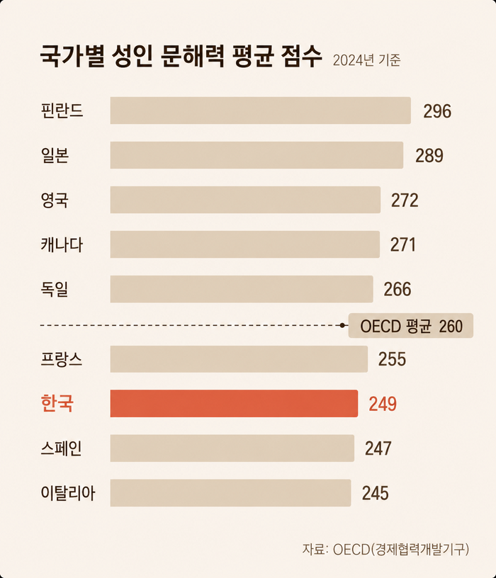

- OECD 국제성인역량조사(PIAAC, 2024)에서 한국 성인 문해력 평균은 **249점**으로 OECD 평균(260점)보다 낮고, 최근 10년간 하락 폭은 참여국 중 1위였습니다.
- 성인의 **58.8%**가 한 달간 책을 한 페이지도 읽지 않았습니다. (국립국어원, 2024)
- 초등 6학년 **3명 중 1명**이 책을 거의 읽지 않습니다. (한국교육과정평가원, 2024)
- 교원의 **95.1%**가 학생들의 문해력 저하를 체감합니다. (한국교원단체총연합회, 2024)
- 그러나 전국 17개 시도교육청 중 문해력 진단을 시행하는 곳은 **서울 1곳**뿐입니다.

 

### 2.2 무엇을 하나

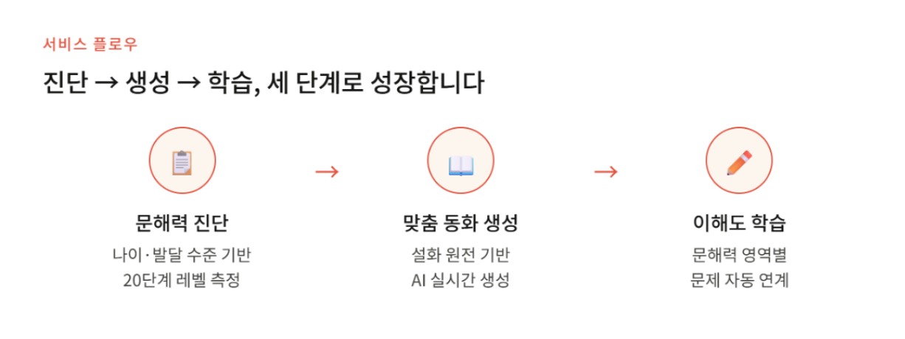

| 단계 | 하는 일 |
| :---: | --- |
| **진단** | 나이와 발달 수준을 기준으로 배치고사를 치러 아이의 현재 단계를 20단계 중 하나로 산정합니다 |
| **생성** | 산정한 단계에 맞춰 AI가 설화 원전을 실시간으로 재구성해 동화를 만듭니다 |
| **학습** | 동화 내용과 연계된 퀴즈로 이해도를 확인하고, 결과에 따라 다음 동화의 난이도가 조정됩니다 |

 

### 2.3 시연 영상

<!-- GitHub 웹 편집 화면에서 docs/video/demo.mp4 를 이 줄 자리에 끌어다 놓으면 재생 플레이어가 생깁니다. -->
https://github.com/user-attachments/assets/e1ff69b1-57f8-4e6a-8691-020fbc652df5

 

### 2.4 서비스 화면

<b>서비스 화면 10장 보기</b>

 

| | |
| :---: | :---: |
| 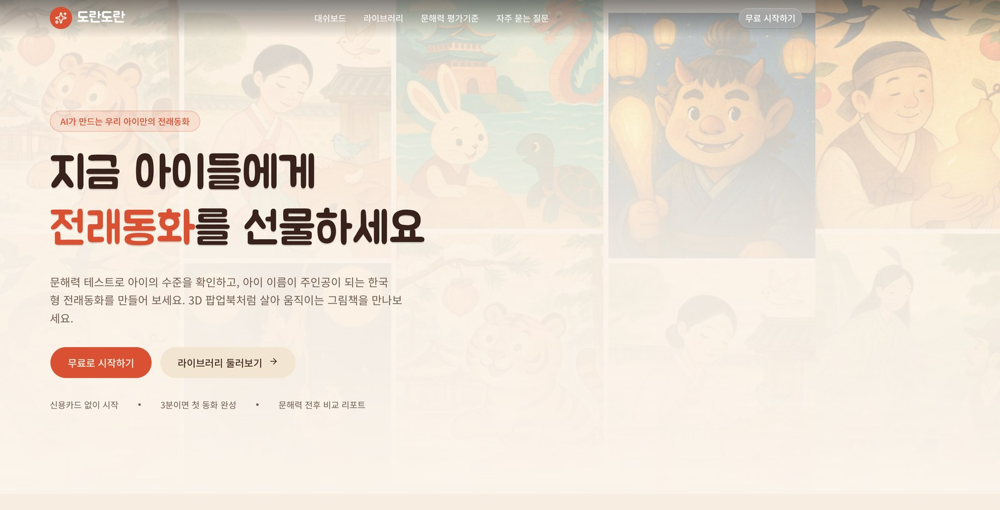 | 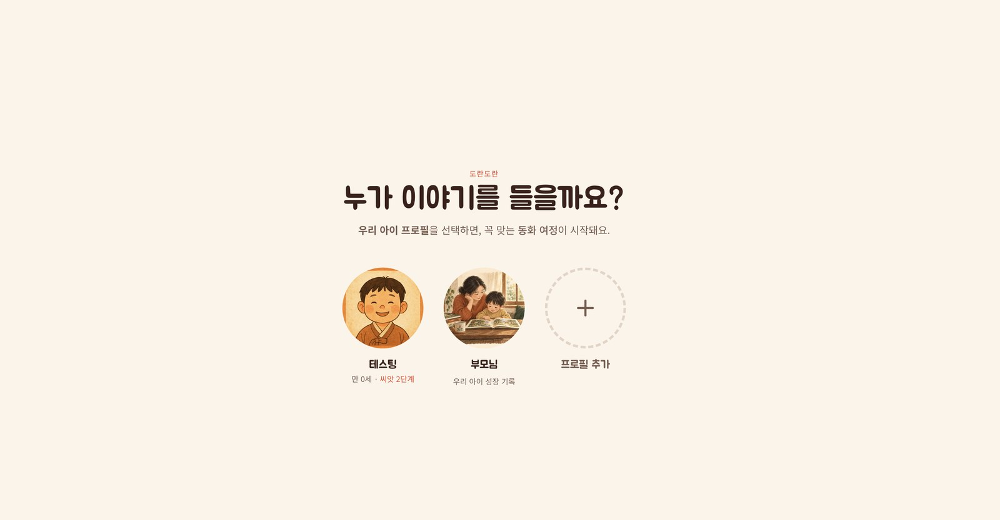 |
| **메인 페이지** | **프로필 선택** |
| 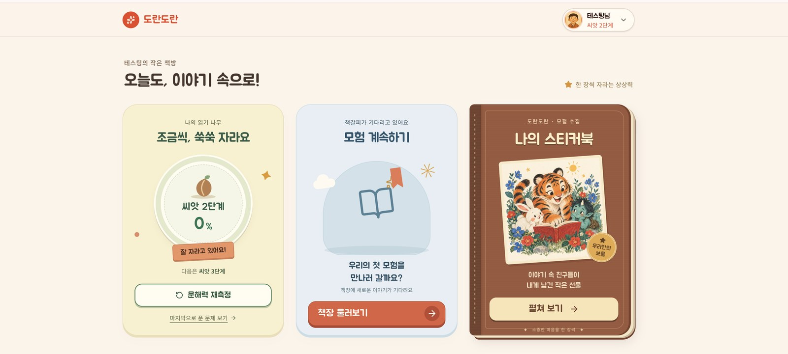 | 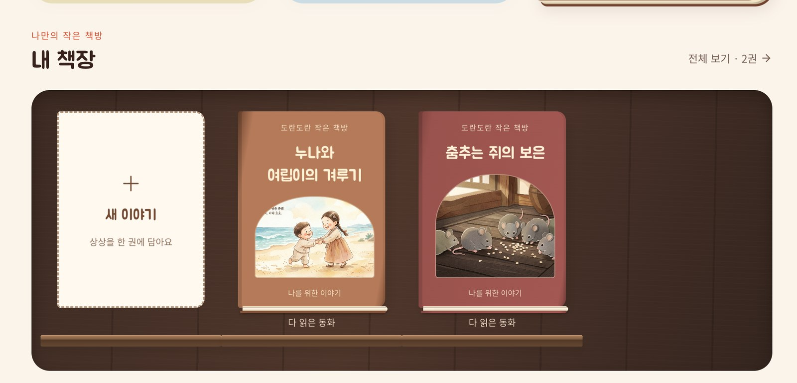 |
| **홈 · 읽기 단계 · 스티커북** | **내 책장** |
| 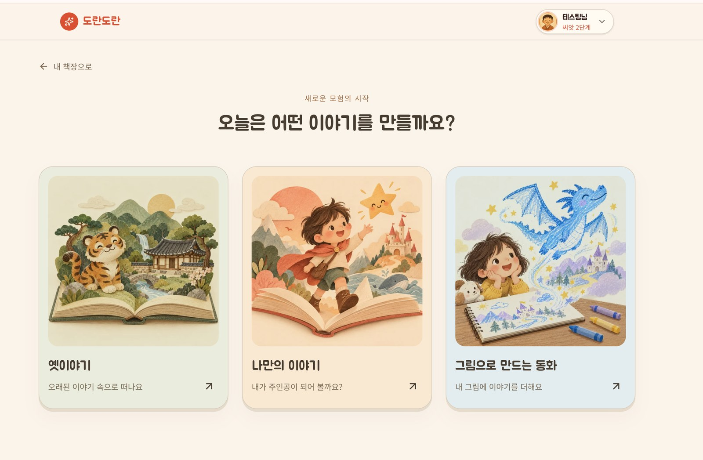 | 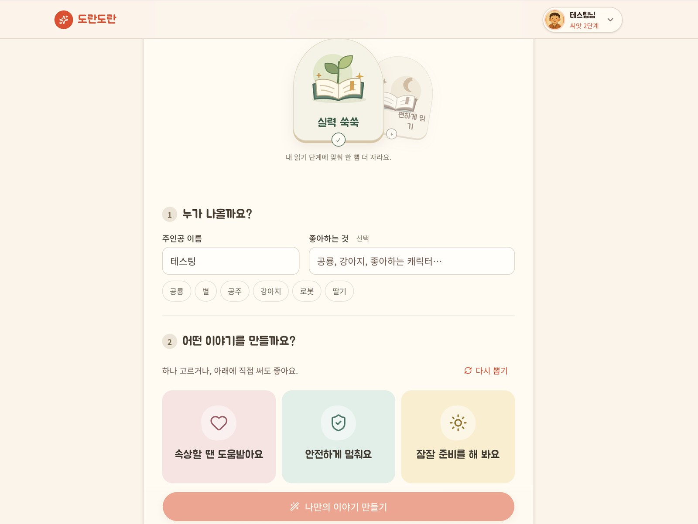 |
| **이야기 종류 선택** | **나만의 이야기 만들기** |
| 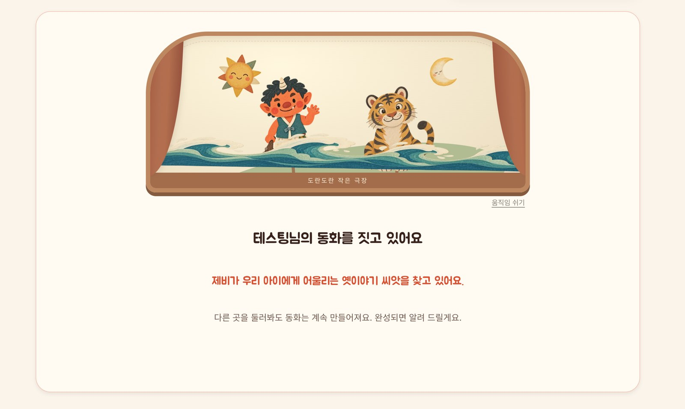 | 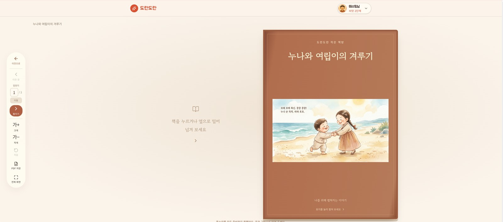 |
| **동화 생성 중 · 작은 극장** | **책 뷰어** |
| 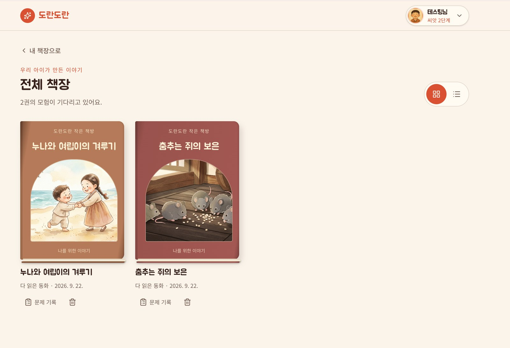 | 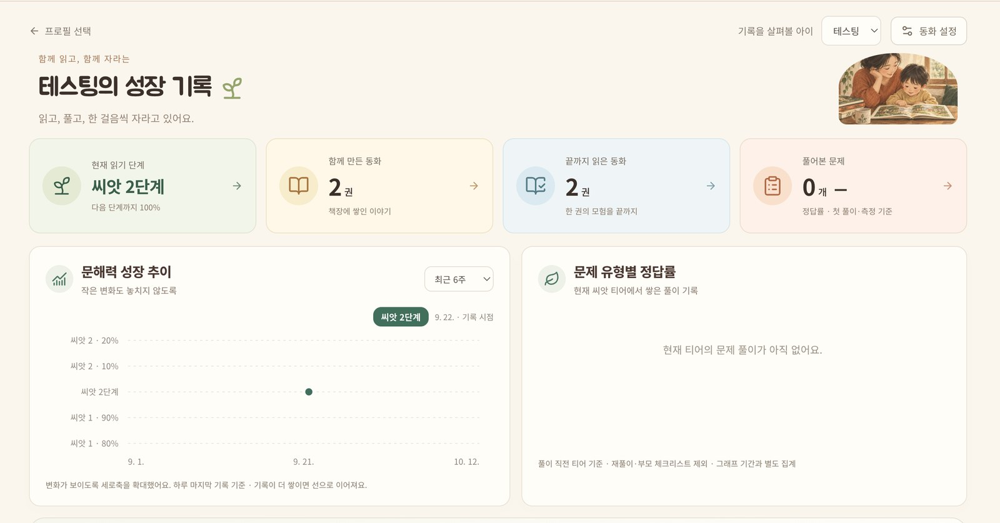 |
| **전체 책장** | **부모님 성장 기록** |

 

---

## 3. 차별성

**"도란도란은 문해력 진단 · 전통문화 공공데이터 · 학습 연계 세 가지를 하나의 흐름으로 묶었습니다."**

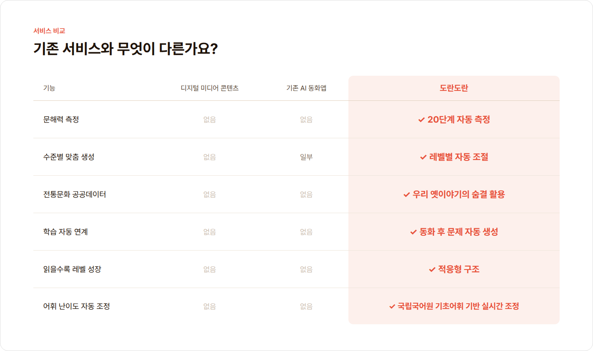

- 기존 AI 동화 앱은 아이의 문해력 수준을 측정하지 않거나, 측정하더라도 전통문화 데이터와 학습 연계를 함께 갖추지 못했습니다.

 

### 3.1 0~10세를 아우르는 20단계 문해력 프레임워크

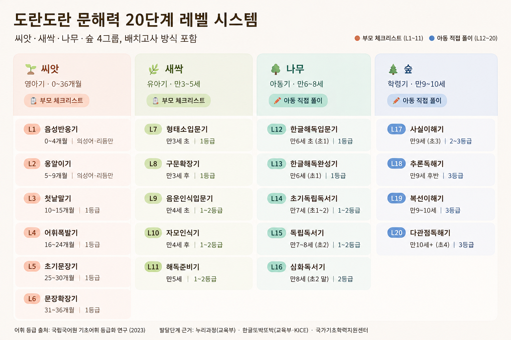

- 국내 언어 발달 연구를 종합해 **0~10세를 20단계로 나눈 자체 척도**를 설계했습니다. 아이의 성장 시기에 맞춰 네 묶음으로 구성됩니다.

| 묶음 | 대상 | 단계 | 읽는 방식 |
| --- | --- | :---: | --- |
| 🌱 씨앗 | 영아기 · 0~36개월 | L1 ~ L6 | 부모님이 읽어 주고 체크리스트로 확인 |
| 🌿 새싹 | 유아기 · 만 3~5세 | L7 ~ L11 | 부모님 체크리스트 |
| 🌳 나무 | 아동기 · 만 6~8세 | L12 ~ L16 | 아이가 직접 퀴즈 풀이 |
| 🌲 숲 | 학령기 · 만 9~10세 | L17 ~ L20 | 아이가 직접 퀴즈 풀이 |

 

#### 설계 근거

| 자료 | 발행 | 프레임워크에서 맡은 역할 |
| --- | --- | --- |
| 한국 영유아 발달선별검사(K-DST) 사용 지침서 | 보건복지부 · 질병관리본부, 2014 | 영아기(0~36개월)의 언어 발달 시기 구분. 음성 반응 → 옹알이 → 첫 낱말 → 어휘 폭발로 이어지는 초기 단계의 기준 |
| 2019 개정 누리과정 해설서 | 교육부, 2019 | 만 3~5세 유아의 의사소통 영역 목표. 듣기·말하기에서 읽기·쓰기로 넘어가는 새싹 단계의 기준 |
| 한글또박또박 | 교육부 · 한국교육과정평가원, 2023 | 자모 인식 → 해독 준비 → 한글 해득으로 이어지는 한글 깨치기 단계 구분 |
| 국어 기초어휘 선정 및 어휘 등급화 연구 | 국립국어원, 2023 | 단계별로 쓸 수 있는 어휘의 범위. 1등급(4\~6세) · 2등급(초1\~2) · 3등급(초3\~4) |

 

- 국립국어원 어휘 등급은 만 4세 이상을 기준으로 만들어져 **영아기 어휘 기준이 비어 있습니다.**
- 이 구간은 K-DST, 누리과정, 한글또박또박을 참고해 별도 파라미터를 설계하고, 1등급 어휘와 의성어·의태어를 발달 단계에 맞게 재구성해 채웠습니다.
- 각 단계는 문장 길이(어절 수), 문법, 받침, 의성어·의태어, 대명사, 사용 어휘 등급 등 **15개 생성 파라미터**로 정의되고, 이 값이 그대로 프롬프트의 언어 지침이 됩니다.

 

<b>20단계 전체 설정표 보기</b>

 

| 단계 | 단계명 | 문장 표현 지침 | 어휘 등급 / 범위 |
| :---: | --- | --- | --- |
| 1 | 음성반응기 | 단어·음절 반복, 자장가형 리듬 | — / 소리 중심 |
| 2 | 옹알이기 | 의성어·반복음 나열, 1~2어절 단위 | — / 소리 중심 |
| 3 | 첫낱말기 | 1~2어절 단문, 사물 명명 중심 | 1등급 / 기본 명사 |
| 4 | 어휘폭발기 | 2~3어절 단문, 명사+동사 조합, 반복 후렴 구조 | 1등급 / 기본 명사 |
| 5 | 초기문장기 | 3~4어절 단문, 인과 없는 사건 나열, 반복 구조 | 1등급 / 기본 명사 |
| 6 | 문장확장기 | 3~4어절 단문 위주, 일상 루틴 서사, 과거·현재 시제 | 1등급 / 일상 어휘 |
| 7 | 형태소입문기 | 4어절 단문, 반복 후렴 구조 | 1등급 / 일상 어휘 |
| 8 | 구문확장기 | 4~5어절, 단순 기승전결, 대화문, 인과 연결어 | 1등급 / 일상 어휘 |
| 9 | 음운인식입문기 | 5~6어절, 라임·운율, 그림으로 내용 유추 가능한 구조 | 1~2등급 |
| 10 | 자모인식기 | 5~6어절, 그림-글자 연계, 받침 없는 단어 위주 | 1~2등급 |
| 11 | 해독준비기 | 6~7어절, 짧고 완결된 이야기, 시제 다양화, 간단한 속담 | 1~2등급 |
| 12 | 한글해득입문기 | 5~6어절 단문, 무받침 단어 위주, 명확한 사건 순서, 짧은 대화문 | 1등급 |
| 13 | 한글해득완성기 | 6~7어절, 단문+간단한 복문, 대화문 활발, 기승전결 완성 | 1등급 |
| 14 | 초기독립독서기 | 7어절 내외 복문, 인과관계 명확, 행동과 대화의 균형 | 1~2등급 |
| 15 | 독립독서기 | 7~8어절 복합문, 대화체 비중 높음, 감정과 행동 연결 | 2등급 |
| 16 | 심화독서기 | 8어절 내외 복합문, 한자어 일부, 감정 변화 서술 | 2등급 |
| 17 | 사실이해기 | 8~9어절 복합문, 한자어·다의어, 사실 중심 서사 | 2~3등급 |
| 18 | 추론독해기 | 9어절 내외 복합문, 감정·동기 묘사, 관용 표현 일부 | 3등급 |
| 19 | 복선이해기 | 9~10어절 복합문·안은문장, 복선, 다양한 논리 접속사 | 3등급 |
| 20 | 다관점독해기 | 10어절 이상 복합문, 비유·반어, 다관점·열린 결말 | 3등급 |

> 20단계는 연구 자료를 동화 생성용으로 재해석한 내부 체계이며, 공인 진단 척도는 아닙니다.

 

### 3.2 같은 이야기가, 수준에 따라 달라집니다

- 같은 『홍길동전』을 씨앗(Lv.3)과 숲(Lv.20) 두 단계로 생성한 결과입니다.

**"원전은 하나지만, 아이가 만나는 문장은 단계마다 다릅니다."**

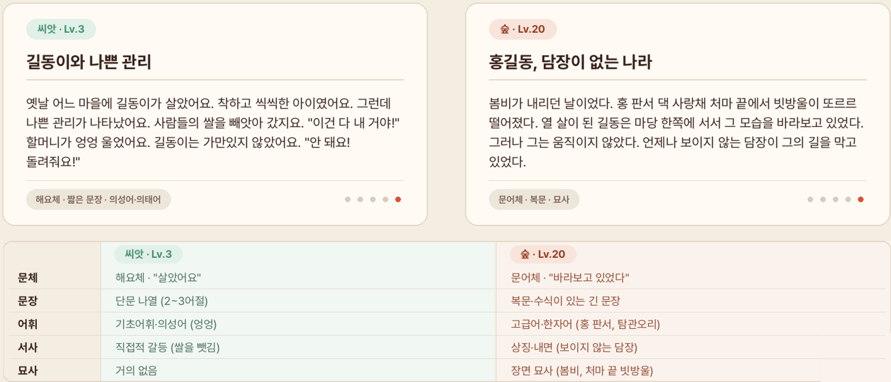

- 씨앗 단계는 해요체와 2~3어절 단문, 의성어로 직접적인 갈등만 보여 줍니다.
- 숲 단계는 문어체 복문과 한자어로 장면을 묘사하고, "보이지 않는 담장" 같은 상징으로 인물의 내면을 그립니다.

📖 [홍길동전 20단계 전체 예시 보기](docs/samples/홍길동전_20단계.md)

 

---

## 4. 시스템 아키텍처 · 기술 스택

### 4.1 시스템 아키텍처

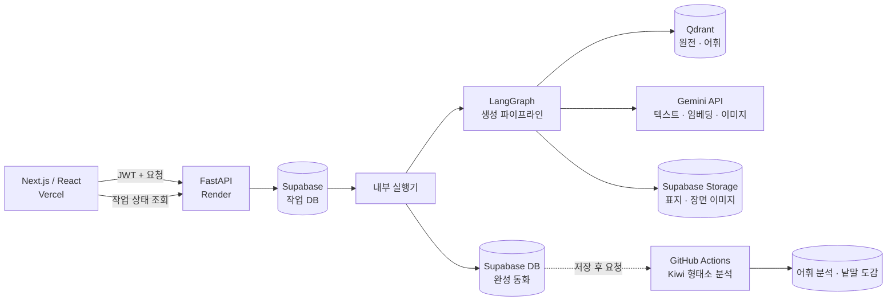

 

- 생성 요청은 DB 작업 큐에 접수되고, 서버 내부 실행기가 순서대로 처리합니다. 사용자는 다른 화면으로 이동해도 진행 상황을 이어서 확인할 수 있습니다.
- 무거운 형태소 분석(Kiwi)은 웹 서버 밖의 GitHub Actions 배치로 분리했습니다.

 

<b>전체 서비스 구성도 보기</b>

 

<a href="docs/readme/service-overview.png">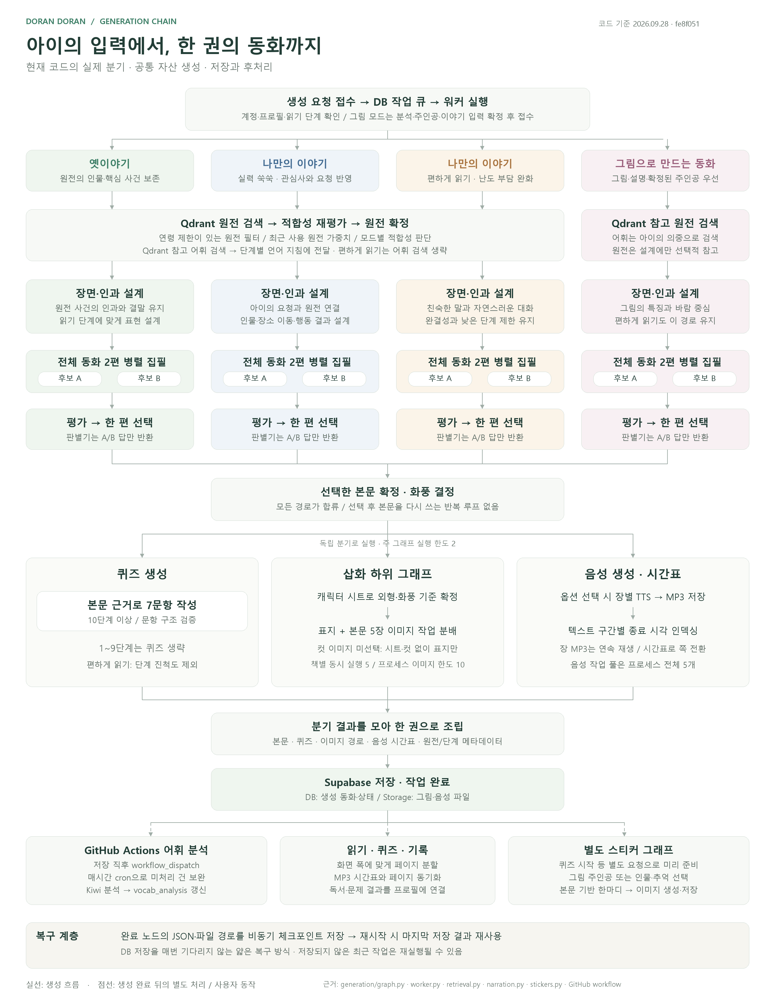</a>

🔍 이미지를 클릭하면 원본 크기로 볼 수 있습니다.

<b>PoC(공모전 버전) 아키텍처 보기</b>

 

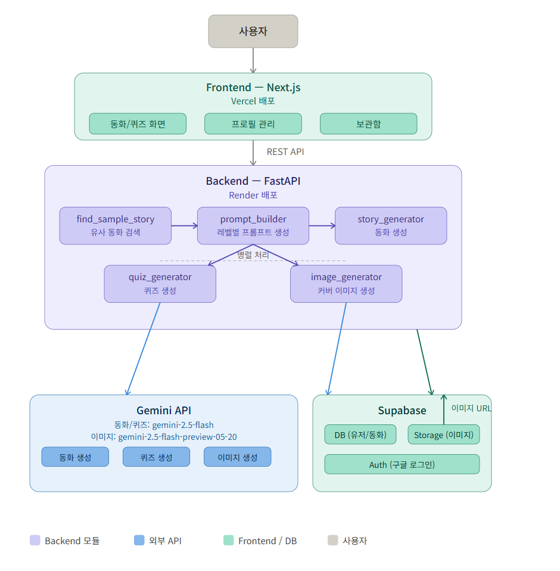

 

📄 자세히 보기: [Frontend 구조](structure/frontend.md) · [Backend 구조](structure/backend.md)

 

### 4.2 기술 스택

| 분류 | 기술 |
| --- | --- |
| **Frontend** | Next.js, React, Vercel |
| **Backend** | FastAPI, Render |
| **AI** | Google Gemini (텍스트 · 임베딩 · 이미지), LangGraph |
| **Vector DB** | Qdrant (`folktales_v1` 원전, `vocab_grade_v1` 어휘) |
| **DB · Auth · Storage** | Supabase |
| **데이터 처리** | Python, pdfplumber, Kiwi |
| **배치** | GitHub Actions |

 

---

## 5. 활용 데이터

### 5.1 데이터 출처

| 데이터 | 제공 기관 | 규모 | 활용 |
| --- | --- | --- | --- |
| 한국민속문학사전 설화편 | 국립민속박물관 (2013) | 표제어 889개 | 동화의 원전. 줄거리와 핵심 화소를 생성 근거로 제공 |
| 국어 기초어휘 선정 및 어휘 등급화 연구 | 국립국어원 (2023) | 1~5등급 어휘 40,000개 | 단계별 사용 어휘 범위 제어 |
| 한국민족문화대백과사전 | 한국학중앙연구원 | 54편 | 원전 확장 (MVP 단계) |
| 한국민속문학사전 설화편 2권 | 국립민속박물관 | 55편 | 원전 확장 (MVP 단계) |

- 두 핵심 데이터 모두 문화체육관광부 산하 공공기관이 발행한 공식 연구 성과물입니다.

 

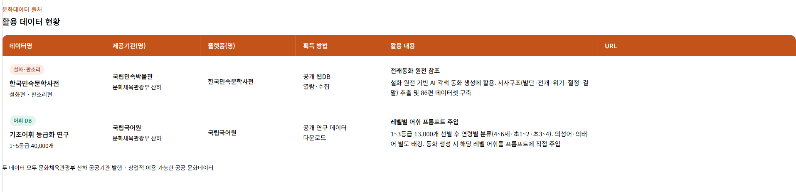

 

### 5.2 데이터 분석 (EDA)

#### 5.2.1 어휘: 국립국어원 기초어휘 DB

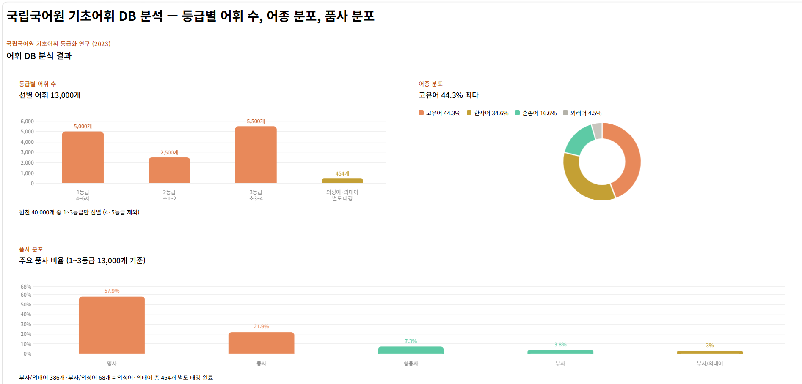

- 1\~5등급 40,000개 중 아동에게 맞는 **1\~3등급 13,000개**를 선별했습니다.
- 1등급 5,000개(4\~6세) · 2등급 2,500개(초1\~2) · 3등급 5,500개(초3\~4)
- 어종은 고유어 44.3% · 한자어 34.6% · 혼종어 16.6% · 외래어 4.5% 순입니다.
- 품사는 명사 57.9% · 동사 21.9% · 형용사 7.3% 비중이 높습니다.
- 부사 중 **의성어·의태어 454개**를 따로 태깅했습니다. 영아기 단계의 핵심 어휘가 됩니다.

 

#### 5.2.2 설화: 한국민속문학사전 설화편

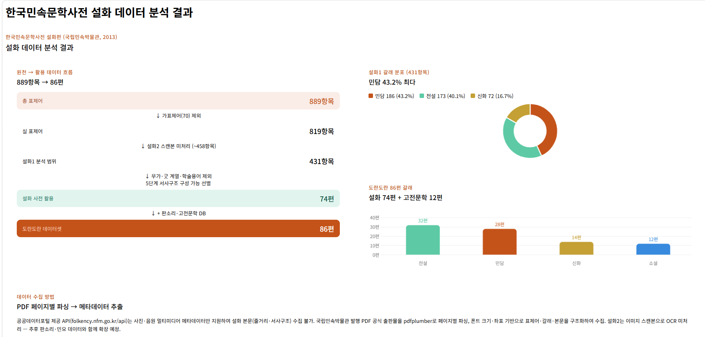

- 총 889개 표제어(가표제어 70개 포함) 중 실 표제어는 819개입니다.
- 갈래는 민담 43.2% · 전설 40.1% · 신화 16.7%입니다.
- 무가·굿 계열과 학술용어 항목을 제외하고, 발단·전개·위기·절정·결말의 5단계 서사로 구성할 수 있는 작품만 골랐습니다.
- 설화 사전 74편에 설화 데이터에 없는 판소리·고전문학 12편(홍길동전 등)을 보완해 **86편**의 데이터셋을 만들었습니다.

 

### 5.3 데이터 처리 과정

#### 5.3.1 어휘 DB (5단계)

1. **원천 로드**: 1~5등급 40,000개 전체 수집
2. **등급 필터**: 4·5등급 제거 → 13,000개
3. **컬럼 정제**: 등급 · 어휘 · 품사 · 어종 · 의미 · 분야 6개 컬럼 유지
4. **의성어·의태어 태깅**: 부사 중 의미 키워드와 반복 패턴으로 추출 (의태어 386개 · 의성어 68개)
5. **오분류 수동 보정**: 21개 수작업 수정

 

#### 5.3.2 설화 데이터 (3단계)

1. **원전 수집**: 공공데이터포털 API는 멀티미디어만 제공해, 공식 출판물 PDF를 pdfplumber로 파싱했습니다. 폰트 크기와 좌표로 표제어 · 갈래 · 본문 구조를 추출했습니다.
2. **서사 구조화**: 발단 · 전개 · 위기 · 절정 · 결말 5단계로 가공하고 갈래 · 하위갈래 · 테마 · 주제 메타데이터를 붙였습니다.
3. **데이터셋 구축**: 86편을 JSON으로 구조화해 저장했습니다.

 

| 파일 | 주요 컬럼 | 행 수 |
| --- | --- | ---: |
| `grade_1~3.csv` | 등급 · 어휘 · 품사 · 어종 · 의미 · 분야 | 13,000 |
| `onomatopoeia.csv` | 어휘 · 품사 | 454 |
| `설화데이터셋_v5.csv` | 제목 · 갈래 · 하위갈래 · 테마 · 서사구조 | 86 |

 

### 5.4 두 데이터의 연계

**"설화 원전은 무엇을 이야기할지, 어휘 DB는 어떤 말로 표현할지 정합니다."**

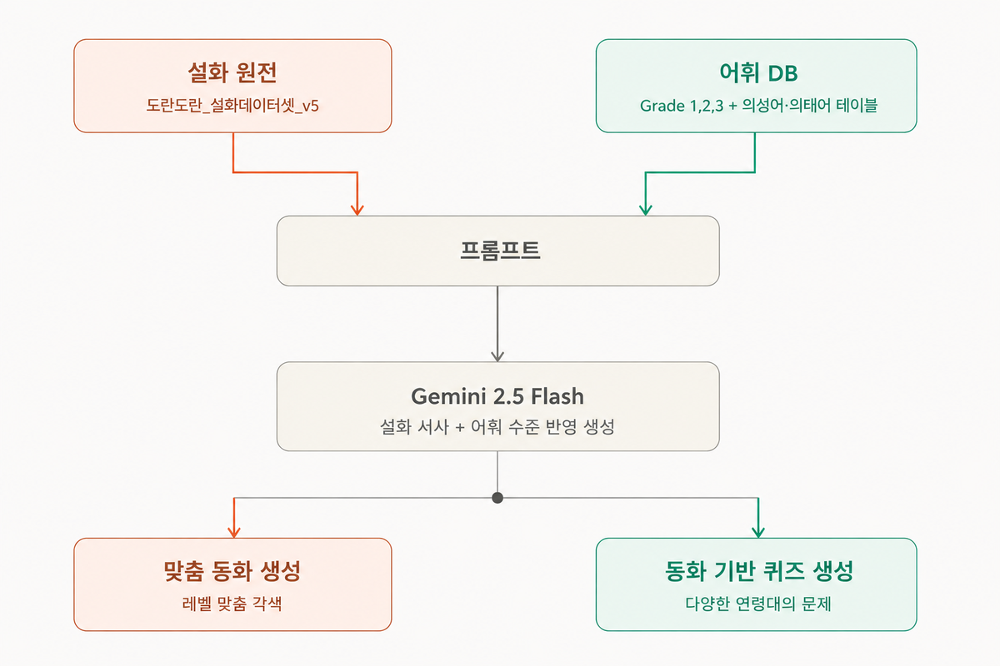

- 두 데이터가 하나의 프롬프트 안에서 만나, 원전의 줄거리는 지키면서 아이 수준에 맞는 문장으로 동화가 만들어집니다.

 

📄 자세히 보기: [Data 구조](structure/data.md)

 

---

## 6. AI 활용

### 6.1 생성 파이프라인 (LangGraph)

- 동화 한 권은 아래 순서로 만들어집니다.
- 공통 장면 계획을 바탕으로 완성본 두 편을 동시에 쓰고, 더 나은 한 편을 고른 뒤 그 본문으로 퀴즈와 그림을 만듭니다.

 

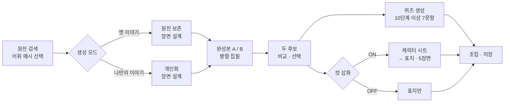

 

| 단계 | 하는 일 |
| --- | --- |
| **장면 설계** | 5개 장면마다 장소, 인물의 의도, 행동, 그 결과, 그림으로 볼 순간을 먼저 정합니다. 앞 장면의 결과가 다음 장면의 시작으로 이어지게 해 인과 공백을 줄입니다. |
| **두 후보 집필** | 같은 설계로 완성본 두 편을 병렬로 씁니다. 단계별 언어 지침(어휘 · 문장 · 받침 · 의성어 · 대명사)을 모두 적용합니다. |
| **후보 선택** | 단계 수준을 크게 벗어난 후보를 먼저 피하고, 인과 공백과 모순이 적은 쪽을 고릅니다. |
| **퀴즈 · 그림** | 선택된 본문 하나로 퀴즈와 그림을 병렬 생성합니다. 캐릭터 시트를 먼저 만들어 장면마다 인물 외형을 맞춥니다. |

 

### 6.2 두 가지 이야기 모드

| | 옛 이야기 | 나만의 이야기 |
| --- | --- | --- |
| **입력** | 연령별 주제 카드 | 이름 · 좋아하는 것 · 주제 · 오늘 있었던 일 |
| **원전 사용** | 인물 · 사건 · 해결 · 결말을 그대로 유지 | 핵심 갈등과 주제를 새 이야기로 각색 |
| **개인화** | 넣지 않음 | 좋아하는 소재를 사건과 해결에 활용 |
| **언어 수준** | 같은 20단계 언어 지침 적용 | 같은 20단계 언어 지침 적용 |

 

### 6.3 RAG: 원전과 어휘를 검색으로 공급

- **원전 RAG**: 질의를 Gemini 임베딩(768차원)으로 바꿔 Qdrant에서 원전을 검색하고, 연령 · 주제 조건으로 범위를 좁힌 뒤 재정렬합니다. 최근에 쓴 원전은 감점해 같은 이야기가 반복되지 않게 합니다.
- **어휘 RAG**: 아이의 단계에 허용된 어휘 등급 안에서만 검색해 최대 8개의 예시 어휘를 고릅니다. 소리 중심인 초기 단계는 별도의 기본 어휘 풀을 씁니다.

 

### 6.4 기술적 한계 극복

- 초기에는 HuggingFace 한국어 임베딩 모델(ko-sroberta-multitask)로 추천 시스템을 만들었지만, 모델 용량이 커서 서버 배포가 불가능했습니다.
- Gemini가 의미 유사성을 직접 추론해 점수를 매기는 방식으로 구조를 바꿔 인프라 비용을 줄였고, 이후 MVP 단계에서 Qdrant 기반 검색과 재정렬 구조로 발전시켰습니다.

 

<b>PoC(공모전 버전) AI Agent 설계도 보기</b>

 

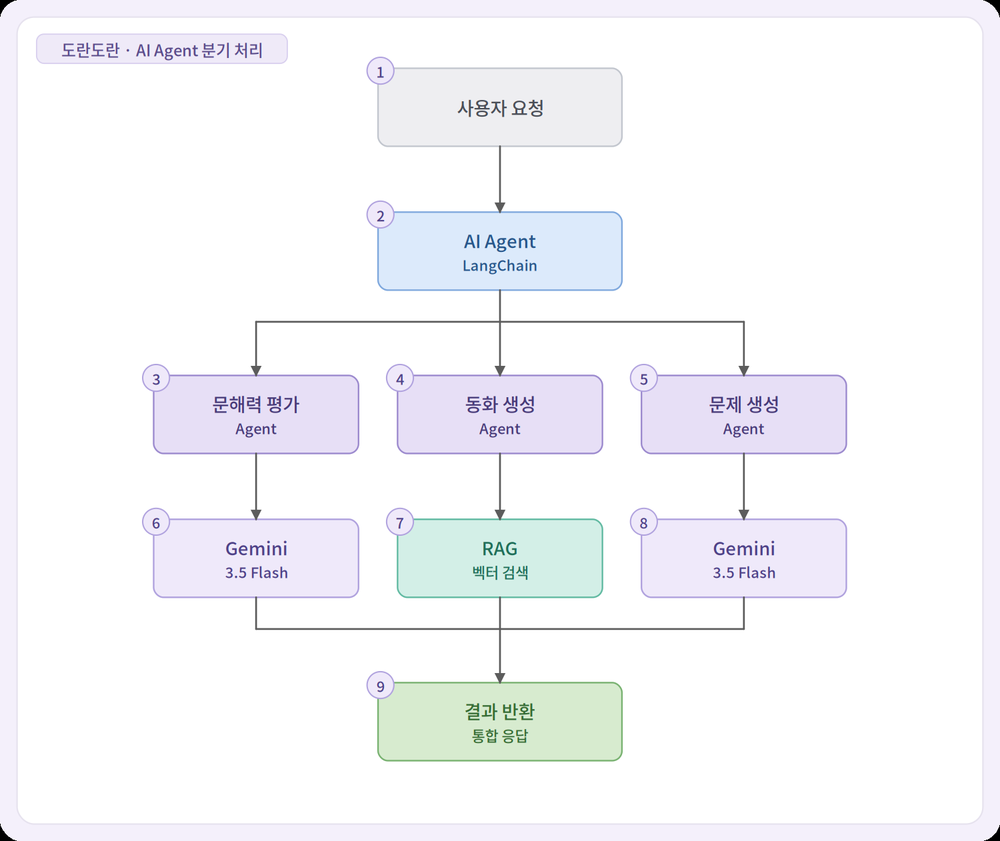

 

---

## 7. 성과

- **제4회 문화체육관광 인공지능·데이터 활용 공모전 대상 (🏆 문화체육관광부 장관상)**
- **범정부 공공데이터·AI 활용 창업경진대회 통합본선 진출**
- **데이터 자산**: 20단계 문해력 프레임워크, 아동용 어휘 13,000개와 의성어·의태어 454개, 동화 원전 195편
- **검증**: 백엔드 회귀 테스트 237개 통과, 원전 검색 · 재정렬 실측 4회 모두 정상 동작 (2026.09.20 기준)

 

---

## 8. 로드맵

### 8.1 PoC: 공모전 버전

**"진단 → 생성 → 학습의 핵심 흐름을 완성한 첫 버전입니다."**

- 배치고사로 20단계 중 현재 단계 산정
- Gemini 2.5 Flash로 설화 원전 86편을 단계별 동화로 실시간 각색
- 단계별 어휘 등급 목록을 프롬프트에 직접 주입
- 동화 기반 퀴즈와 표지 이미지 병렬 생성
- 비회원에게도 공개하는 전래동화 라이브러리

 

### 8.2 MVP: 범정부 창업경진대회 버전

**"PoC를 실제 서비스 수준으로 끌어올린 버전입니다."**

| 변화 | 해결하려던 문제 | 구현 |
| --- | --- | --- |
| **LangGraph 도입** | 모델 · 검색 · 이미지 작업이 얽혀 수정과 측정이 어려움 | 노드 단위 파이프라인, 노드별 시간 · 토큰 기록 |
| **장면 설계 + 두 후보 비교** | 생성 품질의 편차, 높은 단계에서 인과 누락 | 공통 장면 계획 → A/B 완성본 → 비교 선택 |
| **원전 · 어휘 RAG** | 소재와 어휘를 고정 목록에서만 선택 | Qdrant 검색 + 재정렬 |
| **원전 86편 → 195편** | 이야기 다양성 부족 | 한국민족문화대백과사전 54편 · 설화편 2권 55편 각색 · 연결 |
| **두 이야기 모드** | 원전 보존과 개인화 요구가 충돌 | 옛 이야기 / 나만의 이야기 경로 분리 |
| **캐릭터 시트** | 장면마다 인물 외형이 달라짐 | 시트 참조 그림 생성, 장면 번호로 결합 |
| **비동기 생성** | 긴 대기, 화면 이탈 시 작업 유실 | DB 작업 큐, 진행 상태 조회 |
| **부모님 성장 기록 · 낱말 도감** | 문제 결과와 성장 이력이 흩어짐 | 단계 변화 그래프, 영역별 정답률, 책에서 만난 낱말 |
| **만점 스티커북** | 독후 활동의 참여 동기 | 동화당 스티커 1개, 원전 인물 기반 |
| **태블릿 UI** | IR 컨설팅에서 태블릿 사용 환경이 핵심으로 확인됨 | UI를 태블릿 형식으로 전환 |

 

### 8.3 다음 단계

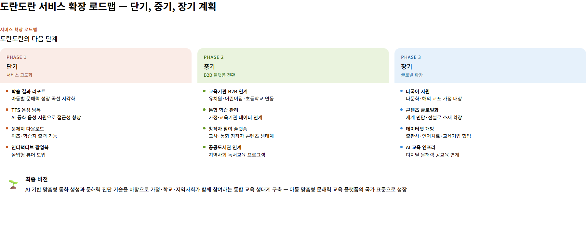

- **단기 · 서비스 고도화**: 아동별 문해력 성장 리포트, 동화 낭독(TTS), 문제지 다운로드, 인터랙티브 팝업북 뷰어
- **중기 · B2B 교육 플랫폼**: 유치원 · 어린이집 · 초등학교용 학습 관리(LMS), 교사 · 창작자 참여 플랫폼, 공공도서관 연계
- **장기 · 글로벌 확장**: 세계 민담 · 고전 동화로 원전 확대, 다국어 지원

 

---

## 9. 참고문헌

### 9.1 참고 자료

- OECD. (2024). *OECD Skills Outlook: Adult Literacy Survey.*
- 한국교원단체총연합회. (2024). 교사 설문조사: 문해력 개선을 위한 핵심 과제.
- 서울특별시교육청. (2024). 서울학생 문해력 진단검사 결과 보고.
- 산업통상자원부. (2025). 국내 에듀테크 시장 규모 추이.
- 좋은책신사고. (2024). 초등 학부모 문해력 교육 현황 설문조사.
- 한국교육과정평가원. (2024). 초등학생 문해력 실태 분석 및 교육 지원 방안 연구: 4~6학년을 중심으로.
- 국립국어원. (2023). 국어 기초어휘 선정 및 어휘 등급화 연구.
- 국립민속박물관. (2013). 한국민속문학사전: 설화편.
- 교육부. (2019). 2019 개정 누리과정 해설서.
- 교육부 · 한국교육과정평가원. (2023). 한글또박또박.
- 보건복지부 · 질병관리본부. (2014). 한국 영유아 발달선별검사(K-DST) 사용 지침서.

 

### 9.2 활용 데이터

1. 국립민속박물관. (2013). 한국민속문학사전 설화편 웹DB. [folkency.nfm.go.kr](https://folkency.nfm.go.kr) · 설화 항목 889건
2. 국립국어원. (2023). 국어 기초어휘 선정 및 어휘 등급화 연구 데이터. [korean.go.kr](https://www.korean.go.kr) · 1~5등급 40,000개
3. 한국학중앙연구원. 한국민족문화대백과사전. [encykorea.aks.ac.kr](https://encykorea.aks.ac.kr) · 54편

