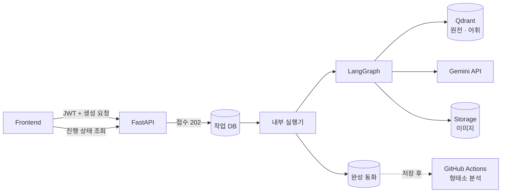
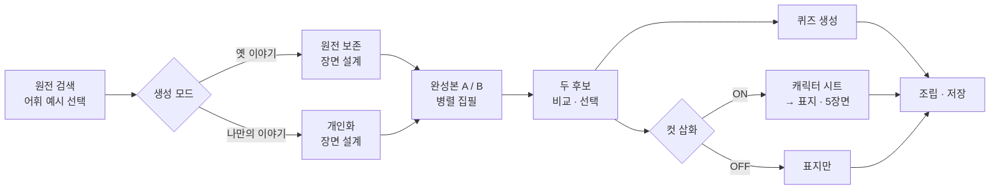

# Backend 구조

> FastAPI · LangGraph · Supabase · Qdrant · Render

동화 생성은 시간이 오래 걸리고 외부 AI 호출이 많기 때문에, **요청 접수와 실제 생성을 분리**하고 생성 과정을 **LangGraph 노드 단위**로 나눴습니다.

 

## 1. 전체 흐름

 

## 2. 생성 요청 처리

| 단계 | 하는 일 |
| --- | --- |
| **접수** | JWT와 프로필 소유권을 확인하고, 같은 요청이 두 번 들어와도 작업이 하나만 생기도록 막은 뒤 작업 DB에 저장합니다. 응답은 작업 번호만 즉시 돌려줍니다. |
| **처리** | 서버 내부 실행기가 DB에서 작업을 하나씩 가져와 처리합니다. 동시에 처리하는 수를 제한하고, 나머지는 DB 대기열에서 기다립니다. |
| **진행 안내** | 노드가 끝날 때마다 상태를 기록하고, 프론트는 이를 주기적으로 조회해 단계별 문구를 보여 줍니다. |
| **완료** | 완성된 동화를 저장하고 작업을 완료 처리합니다. 화면을 떠났다가 돌아와도 결과를 다시 불러올 수 있습니다. |

 

## 3. LangGraph 생성 파이프라인

| 노드 | 역할 |
| --- | --- |
| **검색** | 아이의 연령 · 주제에 맞는 원전을 찾고, 단계에 허용된 어휘 예시를 고릅니다. |
| **장면 설계** | 5개 장면의 상황 · 의도 · 행동 · 결과를 먼저 정해, 장면 사이의 인과가 끊기지 않게 합니다. |
| **병렬 집필** | 같은 설계로 완성본 두 편을 동시에 씁니다. 20단계 언어 지침을 모두 적용합니다. |
| **비교 · 선택** | 단계 수준을 벗어난 후보를 먼저 피하고, 인과 공백이 적은 쪽을 고릅니다. |
| **퀴즈 · 그림** | 선택된 본문 하나로 퀴즈와 그림을 병렬로 만듭니다. 캐릭터 시트를 먼저 만들어 장면마다 인물 외형을 맞춥니다. |

 

## 4. 저장소별 역할

| 저장소 | 담는 것 |
| --- | --- |
| **Qdrant** | 원전 벡터와 어휘 벡터 (검색 전용) |
| **Supabase DB** | 프로필 · 읽기 단계, 생성 작업 상태, 완성 동화, 읽기 기록, 퀴즈 결과, 스티커, 낱말 분석 |
| **Supabase Storage** | 표지 · 장면 이미지, 캐릭터 시트, 스티커 |
| **GitHub Actions** | 저장된 동화의 형태소 분석 배치. 무거운 분석을 웹 서버 밖으로 분리 |

 

## 5. 안정성과 보안

- **인증 · 소유권**: 모든 요청에서 JWT를 검증하고, 계정 · 프로필 · 책의 소유권을 서버에서 다시 확인합니다.
- **출력 구조 검사**: 모델 응답은 정해진 스키마로 검증하고, 구조 오류는 후보당 한 번만 고쳐 씁니다.
- **장애 대응**: 검색이 실패하면 로컬 자료로 대체 검색하고, 대체 여부를 기록합니다. 안전 차단 응답은 우회하지 않고 생성을 멈춥니다.
- **비용 관리**: 노드별 시간 · 토큰 · 모델을 기록해 생성 방식별 비용과 품질을 비교할 수 있게 했습니다.
