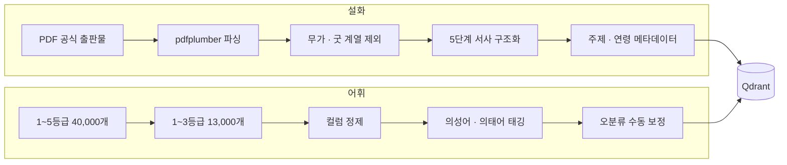

# Data 구조

> 원본 데이터는 이 저장소에 포함하지 않습니다.

도란도란의 동화는 두 데이터가 만나 만들어집니다. **설화 원전은 무엇을 이야기할지**, **어휘 DB는 어떤 말로 표현할지** 정합니다.

 

## 1. 데이터 구성

| 데이터 | 출처 | 규모 | 저장 |
| --- | --- | --- | --- |
| **설화 원전 (MVP)** | 국립민속박물관 「한국민속문학사전 설화편」 + 판소리 · 고전문학 | 86편 | Qdrant 원전 컬렉션 |
| **설화 원전 (확장)** | 한국학중앙연구원 「한국민족문화대백과사전」 | 54편 (각색) | Qdrant 원전 컬렉션 |
| **어휘 DB** | 국립국어원 「국어 기초어휘 선정 및 어휘 등급화 연구」 | 13,000개 | Qdrant 어휘 컬렉션 |
| **의성어 · 의태어** | 어휘 DB 부사에서 별도 태깅 | 454개 | 영아기 단계 어휘 풀 |

 

## 2. 처리 흐름

 

## 3. 원전 메타데이터

| 항목 | 역할 |
| --- | --- |
| **식별자 · 데이터 버전** | 작품 추적과 안전한 갱신. 기존 86편과 확장 54편을 함께 검색 |
| **제목 · 5단계 본문** | 발단 · 전개 · 위기 · 절정 · 결말로 나눈 줄거리. 검색과 집필의 근거 |
| **대표 주제 · 보조 주제** | 8개 주제 (용기와 도전, 정직과 약속, 나눔과 배려, 지혜와 재치, 욕심과 선택, 가족과 우애, 자연과 동물, 신비하고 재미있는 이야기) |
| **출처** | 기관 · URL · 자료 성격. 원문과 각색본을 따로 보관 |
| **최소 연령 (선택)** | 민감한 소재가 있는 작품의 연령 제한 |

 

## 4. 원전 각색 기준 (확장 54편)

원문에 아이에게 맞지 않는 내용이 있으면, 사건의 원인과 해결을 함께 바꿔 이야기가 성립하도록 각색했습니다.

1. 원문에서 쓸 이본이나 에피소드 하나를 고르고, 서로 다른 이본을 설명 없이 이어 붙이지 않습니다.
2. 죽음 · 신체 훼손 · 강요된 관계 · 동물 학대는 사건의 원인과 해결을 함께 바꿉니다.
3. 새로운 도구나 능력을 넣으면 앞 장면에서 미리 보여 줍니다.
4. 신화의 지명 · 인물 · 핵심 소재는 가능한 범위에서 살리고, 크게 바꾼 결말을 원래 전승이라고 주장하지 않습니다.

 

## 5. 단계별 어휘 범위

| 묶음 | 단계 | 어휘 범위 |
| --- | :---: | --- |
| 🌱 씨앗 | L1 ~ L6 | 소리 중심 → 기본 명사 → 일상 어휘 (1등급) |
| 🌿 새싹 | L7 ~ L11 | 1등급 → 1~2등급 |
| 🌳 나무 | L12 ~ L16 | 1등급 → 2등급 |
| 🌲 숲 | L17 ~ L20 | 2~3등급 → 3등급 |

국립국어원 어휘 등급은 만 4세 이상 기준이라 영아기 구간이 비어 있습니다. 이 구간은 K-DST, 누리과정, 한글또박또박을 참고해 별도 어휘 풀을 설계했습니다.
