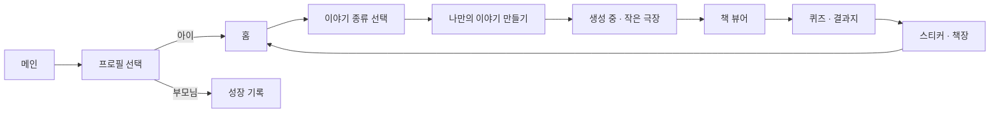

# Frontend 구조

> Next.js · React · Vercel

아이 한 명이 **프로필 선택 → 동화 만들기 → 읽기 → 문제 풀이 → 기록** 순서로 한 권의 모험을 이어 가도록 화면을 구성했습니다. 보호자는 같은 계정에서 부모님 화면으로 아이의 기록을 확인합니다.

 

## 1. 사용자 흐름

 

## 2. 화면 구성

| 화면 | 역할 | 캡처 |
| --- | --- | :---: |
| **메인** | 서비스 소개, 라이브러리, 문해력 평가 기준, FAQ | [보기](../docs/screens/01_main.jpg) |
| **프로필 선택** | 아이 프로필과 부모님 화면 진입점 | [보기](../docs/screens/02_profile.jpg) |
| **홈** | 현재 읽기 단계 · 진척률, 이어 읽기, 스티커북 | [보기](../docs/screens/03_home.jpg) |
| **내 책장** | 만든 동화 목록, 새 이야기 시작 | [보기](../docs/screens/04_bookshelf.jpg) |
| **이야기 종류 선택** | 옛이야기 / 나만의 이야기 / 그림으로 만드는 동화 | [보기](../docs/screens/05_story_type.jpg) |
| **나만의 이야기 만들기** | 주인공 이름, 좋아하는 것, 연령별 주제 카드 3개와 다시 뽑기 | [보기](../docs/screens/06_story_form.jpg) |
| **생성 중** | 종이인형극 애니메이션과 단계별 진행 문구. 다른 화면으로 이동해도 생성은 계속됨 | [보기](../docs/screens/07_generating.jpg) |
| **책 뷰어** | 표지 · 본문 · 뒷표지, 클릭 · 스와이프 · 쪽 이동, 글자 크기 조절, PDF 저장, 전체 화면 | [보기](../docs/screens/08_viewer.jpg) |
| **전체 책장** | 다 읽은 동화, 문제 기록, 휴지통 | [보기](../docs/screens/09_library.jpg) |
| **부모님 성장 기록** | 현재 단계, 만든 · 완독한 책, 푼 문제, 단계 변화 그래프, 문제 유형별 정답률 | [보기](../docs/screens/10_parent.jpg) |

 

## 3. 설계 원칙

- **기다림을 화면 경험으로 바꾸기**: 동화 한 권을 만드는 데 시간이 걸리기 때문에, 생성 요청은 접수만 받고 진행 상황을 주기적으로 조회합니다. 아이는 그동안 작은 극장 애니메이션을 보거나 다른 화면으로 이동할 수 있습니다.
- **화면 크기에 맞춘 쪽 나누기**: 생성된 동화는 5개 장면이지만, 책 뷰어는 화면과 글자 크기에 맞춰 쪽을 다시 나눕니다. 그림은 미리 불러와 넘김이 끊기지 않게 했습니다.
- **태블릿 우선**: IR 컨설팅에서 태블릿 사용 환경이 핵심으로 확인되어, 책 뷰어와 주요 화면을 태블릿 형식으로 전환했습니다.
- **읽던 자리 복원**: 새로고침하거나 다시 들어와도 읽던 위치와 진행 중인 생성 작업을 이어서 보여 줍니다.
